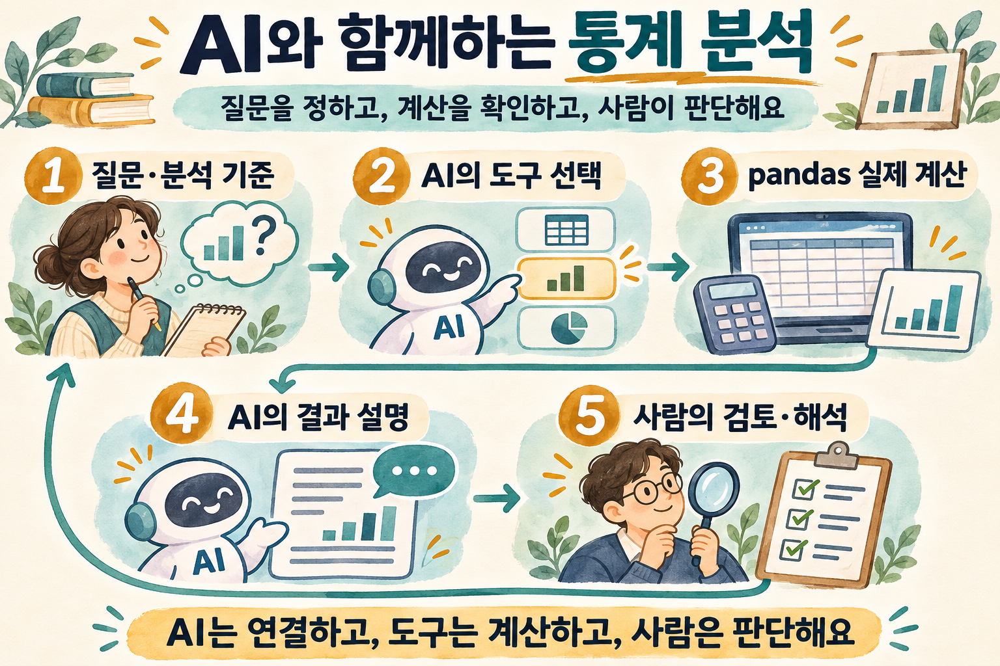
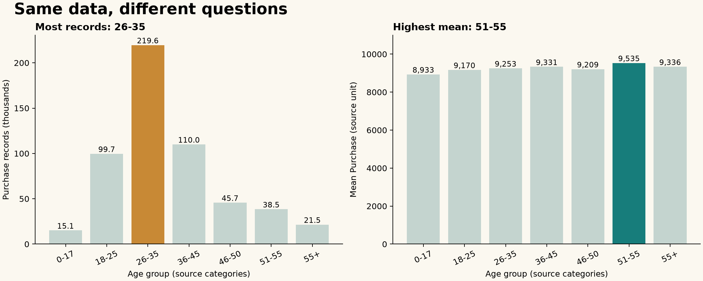

# ChatGPT를 만난 통계 분석

- **도구의 문법을 넘어 분석 질문에 집중하고, 숫자와 해석은 직접 확인하는 자연어 데이터 분석.**
- 강의의 출발점 = R·Python 문법과 환경 설정에 막혀 분석 목적을 포기하는 문제.
- 강의의 목표 = AI로 계산 도구에 접근하고, 분석 단위·비교 기준·근거를 이해하며 자기 판단으로 결론 작성.

<p align="center">
  
</p>

## 강의 읽기와 실습

| 자료 | 담은 내용 |
| --- | --- |
| [강의 본문](docs/lecture.md) | 질문 정의·데이터 이해·도구 연결·실제 결과·해석 검토 |
| [단계별 실습지](docs/practice.md) | 복사할 질문·대조할 숫자·직접 고칠 해석 |
| [계산 재현 코드](examples/analyze_baseline.py) | API 없이 강의 표·숫자·그림 재현 |
| [대화형 실습](handson.py) | LangChain과 pandas의 자연어 도구 호출 |

- 자료 성격 = 기존 README·예제를 바탕으로 새로 재구성한 강의; 과거 발표 원문·녹취와 구분.

## 이 강의가 말하고자 하는 것

- 질문의 구체화 = ‘구매가 많다’를 건수·합계·평균·고객당 금액 중 어떤 뜻으로 쓸지 결정.
- 역할의 분리 = 사람은 질문·기준 설정, AI는 도구 선택·설명, pandas는 실제 계산.
- 근거의 확인 = 모델의 답변과 실제 집계 결과를 대조하고, 행 수·고객 수·결측을 구분.
- 해석의 책임 = 관찰한 차이와 그 원인을 분리하고, 자료로 설명할 수 없는 부분은 미확인으로 기록.

## 같은 데이터, 다른 질문



- 원자료 = [train.csv](data/train.csv), 550,068행·12열; 고유 고객 식별자 5,891개.
- 건수의 답 = `26-35` 구간이 219,587개로 최대; 구매 레코드 수이며 고객 수와 구분.
- 평균의 답 = `51-55` 구간의 평균 `Purchase`가 9,534.81로 최대; 금액 단위는 미확인.
- 학습할 판단 = 건수가 많은 집단·레코드당 금액이 큰 집단·고객당 지출이 큰 집단은 서로 다른 질문.
- 자료 한계 = 수집 기간·원출처·이용 조건 미확인; 위 집계로 연령·소득·선호의 인과관계 단정 불가.

## 실습에서 직접 해볼 일

- 데이터 읽기 = 행·열·자료형·결측 확인, 식별자와 숫자형 측정값 구분.
- 실제 계산 = Purchase의 평균·중앙값 비교, Age별 건수·평균·합계 대조.
- 오류 찾기 = 레코드 수를 고객 수로 설명하거나, 없는 소득 자료로 차이를 설명하는 문장 수정.
- 결론 쓰기 = 데이터 범위·분석 단위·기준·숫자·한계를 담아 자기 문장으로 작성.

## 현재 LangChain 방식으로 갱신한 부분

- 연결 방식 = 기존 `create_csv_agent`·`langchain.llms.OpenAI`·`agent.run` 예제를 `create_agent`·`ChatOpenAI`·`invoke` 흐름으로 교체.
- 도구 정의 = 데이터 구조 확인·숫자 열 요약·집단별 비교로 실행 범위 명시; API 키 없이 로컬 계산 점검 가능.
- 설정 = 코드 안의 API 키 덮어쓰기 제거; `OPENAI_API_KEY`·`OPENAI_MODEL` 환경변수 사용.
- 개념 정정 = LangChain은 모델·도구·에이전트 흐름을 연결하는 프레임워크; Wolfram Alpha와 ChatGPT의 결합만을 뜻하지 않음.
- 확인 기준 = 2026-11-09 공식 문서 대조; [LangChain 시작 안내](https://docs.langchain.com/oss/python/langchain/quickstart) · [모델 연결](https://docs.langchain.com/oss/python/integrations/chat/openai) · [OpenAI 공식 API 안내](https://developers.openai.com/api/docs/quickstart).

## 설치와 로컬 점검

- 환경 = Python 3.11 이상; 별도 가상환경에서 실행.

```bash
python -m venv .venv
# macOS / Linux
source .venv/bin/activate
# Windows PowerShell에서는 .venv/Scripts/Activate.ps1 실행
python -m pip install -r requirements.txt
python handson.py --check
python -m unittest -v
python examples/analyze_baseline.py
```

- `--check` = 행·열·자료형·결측 수 출력; API 호출·비용 발생 없음.
- 다른 자료 = `python handson.py --data 공개자료.csv --check`; CSV만 지원.

### 자연어 분석 실행

- OpenAI 공식 대시보드에서 API 키 생성; 도구 호출을 지원하고 계정에서 사용할 수 있는 모델 선택.
- 설정 = 환경변수 `OPENAI_API_KEY`에 키, `OPENAI_MODEL`에 모델 식별자 입력; 프로그램은 `.env`를 자동으로 읽지 않음.
- 실행 = `python handson.py`; 종료 = 빈 질문 입력.
- 데이터 전달 범위 = 질문·열 정보·집계 결과·대화 기록이 모델 API에 전달될 수 있음; 공개·사용 허가 자료로 실습.

### 직접 해볼 질문

- “행 수와 열 수, 결측이 있는 열을 확인해줘.”
- “Purchase의 평균과 중앙값을 비교하고 유효 관측 수를 알려줘.”
- “Age별 Purchase의 건수·평균·중앙값·합계를 비교해줘. 고객 수와 구매 레코드 수는 구분해줘.”
- “이 결과로 말할 수 있는 사실과 아직 설명할 수 없는 원인을 나눠줘.”

### 강의 그림 재생성

```bash
python -m pip install -r requirements-viz.txt
python examples/analyze_baseline.py --plot
```

- 흐름 삽화 = AI 생성 이미지; 수치 차트 = 원자료를 matplotlib으로 계산·시각화한 결과.

### 검증 범위

- 로컬 데이터 구조·통계 도구는 직접 점검; 모델의 자연어 응답·실제 API 연결은 별도 검증 필요.
- 범위 밖 = 유의성 검정·회귀·인과 추론·그래프 생성; 학습 후 명시적 계산 도구와 검증을 추가할 확장 과제.

## 강연 주제 태그

- AI 통계 분석 · 자연어 데이터 분석 · 데이터 리터러시 · LangChain · pandas · 생성형 AI 교육 · 분석 에이전트.

## 강연 문의 및 제작 과정

- 강연·워크숍 문의: [joygram@gmail.com](mailto:joygram@gmail.com) · 주제·대상·희망 일정 전달.
- 역할: 강연자 — 강의 기획·방향 설정 / AI — 이번 문서·실습 코드 갱신과 로컬 점검 보조.
- 본 강의 자료의 현재화 작업은 AI와 함께 진행; 과거 원본 제작 과정은 미확인.
