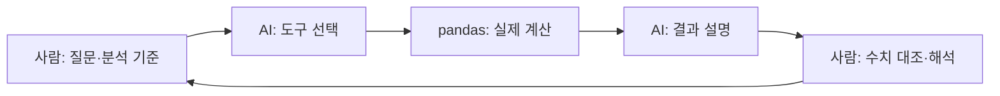

# ChatGPT를 만난 통계 분석

- 자연어 질문을 실제 데이터 계산으로 연결하는 LangChain·pandas 강의와 실습.
- 중심 질문 = **도구의 문법에 막히지 않고 분석 목표에 다가가면서, 결과의 근거와 해석 책임을 어떻게 지킬 것인가?**
- 시작하기 = [실습 코드](handson.py) · [실습 데이터](data/train.csv) · [설치 목록](requirements.txt).

## 이 강의가 말하고자 하는 것

- 출발점 = R·Python 같은 도구를 배우는 진입 장벽 때문에 분석의 본래 질문을 포기하는 상황.
- AI의 기여 = 일상 언어를 분석 작업으로 연결하고, 계산 도구를 사용하는 과정을 보조.
- 학습의 방향 = 원하는 답을 명확히 정의하고, 데이터로 확인한 결과와 자기 해석을 구분하는 역량.
- 도구를 넘어서는 관점 = R·Python·특정 모델의 이름보다 질문·자료·계산·검증의 연결을 이해.

## 지금도 가져가야 할 통찰

### 질문을 구체화하는 일이 분석의 시작

- ‘구매가 많은 집단’ = 구매 건수·총액·건당 평균·고객당 금액 중 어떤 기준인지 먼저 결정.
- ‘몇 개의 데이터’ = 행 수·열 수·고유 고객 수를 구분하고, 한 행이 무엇을 의미하는지 확인.
- 프롬프트 = 대상 변수·비교 집단·집계 기준·결측 처리·원하는 결과 형식을 명시하는 분석 지시.

### 자연어의 편리함과 계산의 근거를 함께 확보

- 모델 = 질문을 해석하고 사용할 도구를 선택; pandas = 실제 집계와 기술통계 계산.
- 검토 = 출력된 숫자를 도구 결과와 대조하고, 분모·결측·이상치·집계 단위 확인.
- 해석 = 집단 간 평균 차이만으로 원인·인과·모집단 전체의 차이를 단정하지 않음.
- 한계 = 필요한 계산이 지원되지 않으면 미수행으로 표시하고 추가 분석을 정의.



## 실습에서 보여주고자 하는 점

- 데이터 점검 = 행·열·자료형·결측 수를 먼저 살펴 질문이 실제 열과 연결되는지 확인.
- 기술통계 = 구매금액의 평균·중앙값·범위를 보고 하나의 요약값이 감추는 차이 질문.
- 집단 비교 = 같은 자료에서 건수·평균·중앙값·합계를 함께 보고 ‘많다’의 의미 비교.
- 대화 연결 = 앞선 결과를 바탕으로 질문을 좁히고, 새 답에서도 계산 근거 확인.
- 코드의 역할 = 승인된 읽기 전용 집계 도구 세 개 제공; 모델이 임의 Python 코드를 생성·실행하는 방식과 구분.

## 데이터로 무엇을 확인할 수 있는가

- 포함 파일 = `data/train.csv`; 550,068행·12열의 구매 관련 예제 데이터.
- 주요 열 = 고객 식별자 `User_ID`, 상품 식별자 `Product_ID`, 연령 구간 `Age`, 구매금액 `Purchase` 등.
- 분석 단위 = 고객·상품 조합의 구매 레코드; 같은 고객이 여러 행에 등장하므로 행 수를 고객 수로 해석하지 않음.
- 주의 = 식별자·직업 코드·상품 범주 번호는 수치 크기 자체에 양적 의미를 부여하지 않음.
- 출처 상태 = 기존 저장소의 데이터 유지; 원출처·수집 범위·이용 조건은 저장소에서 확인되지 않아 재배포·실무 사용 전 확인 필요.

## 본 강의에서 얻어갈 점

- 문제 정의 = 막연한 관심을 변수·집계 단위·비교 기준이 있는 질문으로 전환.
- 데이터 이해 = 결측·자료형·식별자·반복 관측을 살피는 습관.
- 도구 연결 = AI의 언어 처리와 실제 계산 도구의 역할 구분.
- 결과 검토 = 설명의 그럴듯함과 숫자의 정확성을 나눠 확인.
- 판단 기록 = 사용한 기준·확인한 사실·자료의 한계·추가 분석을 함께 설명.

## 현재 LangChain 방식으로 갱신한 부분

- 연결 방식 = 기존 `create_csv_agent`·`langchain.llms.OpenAI`·`agent.run` 예제를 `create_agent`·`ChatOpenAI`·`invoke` 흐름으로 교체.
- 도구 정의 = 데이터 구조 확인·숫자 열 요약·집단별 비교로 실행 범위 명시; API 키 없이 로컬 계산 점검 가능.
- 설정 = 코드 안의 API 키 덮어쓰기 제거; `OPENAI_API_KEY`·`OPENAI_MODEL` 환경변수 사용.
- 개념 정정 = LangChain은 모델·도구·에이전트 흐름을 연결하는 프레임워크; Wolfram Alpha와 ChatGPT의 결합만을 뜻하지 않음.
- 확인 기준 = 2026-11-09 공식 문서 대조; [LangChain 시작 안내](https://docs.langchain.com/oss/python/langchain/quickstart) · [모델 연결](https://docs.langchain.com/oss/python/integrations/chat/openai) · [OpenAI 공식 API 안내](https://developers.openai.com/api/docs/quickstart).

## 설치와 로컬 점검

- 환경 = Python 3.11 이상; 별도 가상환경에서 실행.

```bash
python -m venv .venv
# macOS / Linux
source .venv/bin/activate
# Windows PowerShell에서는 .venv/Scripts/Activate.ps1 실행
python -m pip install -r requirements.txt
python handson.py --check
python -m unittest -v
```

- `--check` = 행·열·자료형·결측 수 출력; API 호출·비용 발생 없음.
- 다른 자료 = `python handson.py --data 공개자료.csv --check`; CSV만 지원.

### 자연어 분석 실행

- OpenAI 공식 대시보드에서 API 키 생성; 도구 호출을 지원하고 계정에서 사용할 수 있는 모델 선택.
- 설정 = 환경변수 `OPENAI_API_KEY`에 키, `OPENAI_MODEL`에 모델 식별자 입력; 프로그램은 `.env`를 자동으로 읽지 않음.
- 실행 = `python handson.py`; 종료 = 빈 질문 입력.
- 데이터 전달 범위 = 질문·열 정보·집계 결과·대화 기록이 모델 API에 전달될 수 있음; 공개·사용 허가 자료로 실습.

### 직접 해볼 질문

- “행 수와 열 수, 결측이 있는 열을 확인해줘.”
- “Purchase의 평균과 중앙값을 비교하고 유효 관측 수를 알려줘.”
- “Age별 Purchase의 건수·평균·중앙값·합계를 비교해줘. 고객 수와 구매 레코드 수는 구분해줘.”
- “이 결과로 말할 수 있는 사실과 아직 설명할 수 없는 원인을 나눠줘.”

### 검증 범위

- 로컬 데이터 구조·통계 도구는 직접 점검; 모델의 자연어 응답·실제 API 연결은 별도 검증 필요.
- 범위 밖 = 유의성 검정·회귀·인과 추론·그래프 생성; 학습 후 명시적 계산 도구와 검증을 추가할 확장 과제.

## 강연 주제 태그

- AI 통계 분석 · 자연어 데이터 분석 · 데이터 리터러시 · LangChain · pandas · 생성형 AI 교육 · 분석 에이전트.

## 강연 문의 및 제작 과정

- 강연·워크숍 문의: [joygram@gmail.com](mailto:joygram@gmail.com) · 주제·대상·희망 일정 전달.
- 역할: 강연자 — 강의 기획·방향 설정 / AI — 이번 문서·실습 코드 갱신과 로컬 점검 보조.
- 본 강의 자료의 현재화 작업은 AI와 함께 진행; 과거 원본 제작 과정은 미확인.
