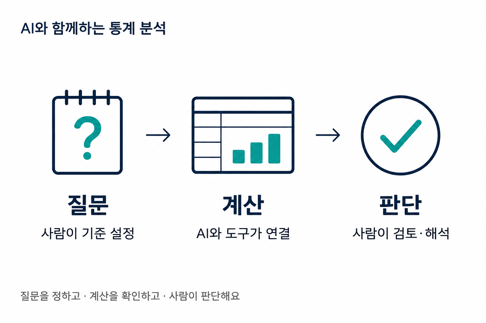
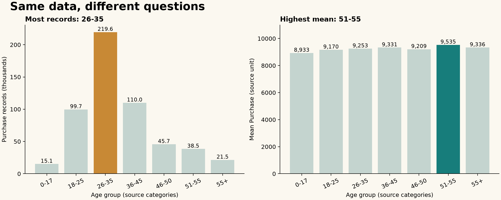

# ChatGPT를 만난 통계 분석 · 강의 본문

- 자료 성격 = 기존 README·실습을 바탕으로 현재화한 학습 본문; 과거 발표 원문·녹취·실시간 AI 답변과 구분.
- 읽는 순서 = 질문 정의 → 데이터 이해 → 도구 연결 → 실제 결과 → 해석과 검토.
- 함께 열기 = [실습지](practice.md) · [계산 재현 코드](../examples/analyze_baseline.py) · [대화형 실습](../handson.py).

## 1. 도구를 배우다가 분석 목적을 잃지 않기

### 출발점

- 분석하고 싶은 문제는 있지만 패키지 설치·문법·함수 선택에서 작업 중단.
- 자연어 인터페이스 = 하고 싶은 일을 표현하고 계산 도구에 연결하는 진입점.
- 학습 목표 = 질문을 정확하게 만들고 실행한 계산을 이해하며, 결과를 설명할 수 있는 상태.

### 달라지는 역할

- 사람 = 질문·비교 기준·자료의 적합성 결정, 해석과 다음 행동 판단.
- AI = 요청을 도구 호출로 연결하고 결과를 설명; 계산 결과와 다른 주장은 검토 대상.
- pandas = 명시된 데이터에 정해진 계산 수행; 변수 선택·집계 기준의 적절성까지 보장하지 않음.

## 2. ‘구매가 많은 연령대’부터 구체화하기

### 한 질문에 숨어 있는 여러 기준

| 질문 | 계산 기준 | 필요한 확인 |
| --- | --- | --- |
| 구매 기록이 많은가 | 행 수 | 한 행의 의미 |
| 지출 규모가 큰가 | Purchase 합계 | 기간·금액 단위 |
| 한 기록의 금액이 큰가 | Purchase 평균·중앙값 | 결측·이상치 |
| 고객 한 명이 많이 쓰는가 | 고객별 집계 후 비교 | 고객 식별·반복 관측 |

### 요청을 바꾸는 예

- 시작 질문 = “구매가 많은 연령대를 알려줘.”
- 구체화 = “Age별 Purchase의 유효 건수·합계·평균·중앙값을 비교하고, 건수와 평균이 가장 큰 집단을 구분해줘.”
- 해석 조건 = “자료의 금액 단위·수집 기간은 미확인으로 남기고, 평균 차이를 구매 원인으로 설명하지 마.”

### 사람이 먼저 결정할 것

- 비교 대상 = 전체 레코드인지 특정 기간·조건인지 확정.
- 비교 단위 = 구매 레코드·고객·상품 중 하나 선택.
- 데이터에 없는 기간·통화·수집 조건은 추정하지 않고 추가 확인 항목으로 기록.

## 3. 데이터가 무엇인지 먼저 읽기

### 실제 파일에서 확인한 구조

- 파일 = [train.csv](../data/train.csv); 550,068행·12열.
- `User_ID` 고유값 = 5,891개; 행 수와 고유 식별자 수의 차이 확인.
- `Product_ID` 고유값 = 3,631개; 고객·상품이 반복 등장하는 구조.
- 실습의 계산 단위 = 한 행의 구매 관련 레코드; 원자료의 거래 정의·수집 방식은 별도 확인 필요.

### 변수의 숫자와 의미 구분

- `Purchase` = 구매금액 관련 수치; 통화·가격 기준은 원출처 확인 전 미확인.
- `Age` = `0-17`, `18-25`, `26-35` 등의 연령 구간; 정확한 나이와 구분.
- `User_ID`·`Occupation`·상품 범주 번호 = 식별자·코드; 평균을 계산할 수 있다는 이유로 의미를 부여하지 않음.
- `Gender`·`Marital_Status` 등 = 원자료의 분류 값; 표본 집계를 사람 전체의 특성으로 일반화하지 않음.

### 결측값을 읽는 방법

- `Product_Category_2` 결측 = 173,638개; `Product_Category_3` 결측 = 383,247개.
- `Purchase` 결측 = 0개; 이 파일에서는 해당 값의 유효 관측 수와 전체 행 수 일치.
- 결측의 뜻 = 미기재·미해당·수집 실패 중 무엇인지 데이터 설명서 확인 필요.
- 임의 처리 금지 = 결측을 0으로 채우면 범주나 평균의 의미가 달라질 수 있음.

## 4. LangChain이 분석 도구를 연결하는 방식

### 질문에서 결과까지

- 모델이 질문과 도구 설명을 읽고 필요한 도구·인자를 선택.
- 프로그램이 pandas 계산을 실행하고 결과를 모델에 전달.
- 모델이 결과를 한국어로 설명; 터미널의 `[계산 근거]`와 답변의 숫자 대조.
- 후속 질문은 앞선 대화와 함께 전달; 새 집계가 필요한 질문은 다시 도구 실행 여부 확인.

### 이 실습의 세 도구

| 도구 | 하는 일 | 확인할 결과 |
| --- | --- | --- |
| `inspect_data` | 구조·결측 집계 | 행·열·자료형·결측 수 |
| `summarize_numeric` | 숫자 열 기술통계 | 유효 건수·평균·분위수·범위 |
| `compare_groups` | 집단별 집계 | 유효 건수·평균·중앙값·합계 |

### 범위와 제약

- 데이터 읽기 전용; 임의 Python 코드 실행·파일 수정·외부 자료 검색 기능 없음.
- 그룹 50개 초과는 오류로 반환; 식별자별 대량 결과를 모델에 보내는 동작 제한.
- 검정·회귀·그래프 생성은 대화형 도구의 범위 밖; 별도 계산 코드와 점검을 추가할 확장 과제.
- API에 질문·집계 결과·대화 기록이 전달될 수 있으므로 공개·사용 허가 자료로 실습.

## 5. 실제 숫자로 답을 대조하기

### 전체 Purchase의 요약

| 지표 | 실제 계산값 |
| --- | ---: |
| 유효 레코드 수 | 550,068 |
| 평균 | 9,263.97 |
| 중앙값 | 8,047 |
| 최솟값 / 최댓값 | 12 / 23,961 |

- 평균이 중앙값보다 큼; 높은 값의 영향과 분포를 추가로 살펴볼 질문으로 연결.
- 위 수치만으로 이상치 여부나 분포의 원인을 확정하지 않음.
- 금액의 단위는 원출처 미확인; 임의로 원·달러 표기 금지.

### 같은 데이터에서 달라지는 답

| Age | 유효 건수 | 평균 Purchase | 중앙값 | 합계 |
| --- | ---: | ---: | ---: | ---: |
| 0-17 | 15,102 | 8,933.46 | 7,986 | 134,913,183 |
| 18-25 | 99,660 | 9,169.66 | 8,027 | 913,848,675 |
| 26-35 | 219,587 | 9,252.69 | 8,030 | 2,031,770,578 |
| 36-45 | 110,013 | 9,331.35 | 8,061 | 1,026,569,884 |
| 46-50 | 45,701 | 9,208.63 | 8,036 | 420,843,403 |
| 51-55 | 38,501 | 9,534.81 | 8,130 | 367,099,644 |
| 55+ | 21,504 | 9,336.28 | 8,105.5 | 200,767,375 |

### 결과를 해석하는 문장

- 건수 기준 = 이 파일에서 `26-35` 집단의 구매 레코드가 219,587개로 가장 많음.
- 평균 기준 = `51-55` 집단의 레코드당 평균 Purchase가 9,534.81로 가장 큼.
- 함께 읽기 = 가장 많은 레코드가 있는 집단과 레코드당 평균이 가장 큰 집단은 다름.
- 해석의 한계 = 고객당 지출·소득·선호·연령의 인과효과는 위 집계만으로 확정 불가.

## 6. AI의 답에서 검토할 지점

### 그럴듯하지만 고쳐야 할 문장

- “26–35세 고객이 219,587명” → 구매 레코드 수를 고객 수로 바꾼 오류; 고유 고객 수 별도 계산 필요.
- “51–55세는 소득이 높아 구매액이 크다” → 소득 자료와 인과 근거 없는 원인 추정.
- “평균이 높으므로 통계적으로 유의하다” → 검정·가정·효과크기 확인 없이 유의성 판단 불가.
- “가장 큰 금액이므로 이상치다” → 분포·측정·업무 기준 확인 없이 삭제 판단 불가.

### 고쳐 쓰는 연습

- 좋은 결론 = 데이터 범위 + 분석 단위 + 비교 기준 + 실제 숫자 + 한계.
- 수정 예 = “이 파일의 구매 레코드 기준으로 51–55세 구간의 평균 Purchase가 가장 크지만, 고객당 지출이나 차이의 원인은 추가 분석이 필요함.”
- 기록 = AI가 제안한 문장, 사람이 바꾼 부분, 숫자를 확인한 계산을 함께 보관.

## 7. 직접 실습하고 다음 질문 만들기

### 실행 순서

- 환경·키 설정 = [README 실행 안내](../README.md#설치와-로컬-점검).
- API 없이 재현 = `python examples/analyze_baseline.py`.
- 그림 재생성 = `python -m pip install -r requirements-viz.txt` → `python examples/analyze_baseline.py --plot`.
- 대화형 실습 = `python handson.py`; [실습지](practice.md) 질문을 순서대로 입력.

### 마무리 확인

- 무엇을 알고 싶었으며 어떤 비교 기준을 정했는가?
- 실제로 계산한 것은 고객 수인가, 구매 레코드 수인가?
- AI의 설명과 도구 결과가 일치하는가?
- 아직 확인하지 않은 자료의 조건과 다음 분석은 무엇인가?

---

- 역할: 강연자 — 강의 기획·방향 설정 / AI — 이번 학습 본문·실습·이미지 재구성과 계산 점검 보조.
- 이 학습 본문은 AI와 함께 제작; 과거 발표 원문과 실시간 모델 실행 결과는 미확인.
